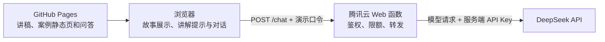

# 架构与部署



正式交互站位于 `/interactive/`。案例瀑布和 AI 问答同页显示，宽屏并排，窄屏上下排列。卡片直接打开 `/examples/<id>/`，每篇正文和独有版式都写在对应案例目录的 `index.html`。案例阅读只发起静态文件 GET 请求。`/demo/` 测试页从同一份 JSON 读取案例。页内问答的锚点是 `/interactive/#ask`，模板和运行脚本分别为 `scripts/interactive-ask.html` 和 `interactive/chat.js`。原有问答地址会转到这个锚点。

「AI 问答」发送事件讲解提示词、最近的问答和本次问题。选择内置案例不会影响问答。在本地 `--cloud` 模式中，转发程序先检索本地案例库，再用当前问题的事件关键词查询 Google 新闻。外部请求只发送关键词，检索结果提供标题、发布方、日期和原文入口。模型会在有明确匹配或用户要求列举多件事时直接回答。用户明显指单一事件、而几个候选同样吻合且会改变结论时，才追问确认。

浏览器只在当前页面内存中保留口令和对话。腾讯云函数校验口令，将消息转发到 DeepSeek，并把回答以 JSON 返回。网页用禁用原生 HTML 与图片的 Markdown 渲染器显示回答。本地的 `scripts/dev.cjs` 在回环地址提供交互站、测试页和相同的 API 处理器，默认在上游调用处返回模拟结果。接口自测位于 `tests/api.cjs`。GitHub Pages 问答直接请求腾讯云函数。外部检索当前由本地 `--cloud` 转发服务提供。

## 案例库

案例库目前收录 20 个案例。每件事有独立目录，目录名与 `id` 相同，只用小写字母、数字和连字符。

```text
examples/
  index.json
  article.css        # 文章页的共用排版基础
  <id>/
    index.html        # 手写文章及本篇版式
    case.json         # 卡片元数据、事实与出处
    media.json        # 可选，登记图片和报道配图入口
    background.jpg    # 图名依案例而定
```

新增案例时，把 `index.html`、`case.json` 和可选图片放在新的 `examples/<id>/`，让 `case.json` 的 `id` 与目录名一致。文章可引用 `../article.css` 并写自己的局部样式。删除案例时移除整个对应目录。增删目录或修改卡片标题、封面后，在仓库根目录运行 `node scripts/build-interactive.cjs`。它扫描案例文件夹，刷新 `examples/index.json` 和入口卡片。既有案例保留排序，新目录排在后面。提交案例目录和更新后的索引、入口文件，再启动或重启本地服务。

`index.json` 使用 `schema_version: 2`，索引自动登记 `file`（案例数据）、`page`（手写网页）和可选的 `media`（图片登记）。这些路径相对 `examples/`。

案例页统一引用 `../article.css`。纸色、深蓝强调色、标题与正文、导航、图注、来源样式都在这里维护。`.article--narrow` 适合窄列叙事，`.article-note` 和 `.article-facts` 用于文中确有需要的补充材料或数字。每页的局部 CSS 负责分栏、照片位置和响应式排布。

| 字段 | 内容 |
| --- | --- |
| `id`、`title`、`tags` | 唯一编号、课堂标题和主题标签 |
| `navigation` | 导航用的 `title`（最多 7 字）和 `subtitle`（最多 15 字）。用正文里的动作或物件刻画人物，保留独立的完整案例标题供查找 |
| `story` | 约 150–250 字的开场故事。含 `type`、`text`、`source_ids` |
| `presentation` | 页面直接展示的讲稿。含 `event`（事件经过）和 `analysis`（理念解读），正文依据同文件的事实与原文 |
| `context` | `time`、`location`、`project_type`、`background`、`source_ids` |
| `facts` | 每条含 `id`、`text`、`source_ids`，口径与来源一致 |
| `analysis` | 每条含 `concept`、`interpretation`、`fact_ids`，说明解读所依据的事实 |
| `sources` | 每条含 `id`、`title`、`publisher`、`date`、`url` |
| `notes` | 可选。记录待核实细节、人物区分或报道范围 |

`source_ids` 指向同一文件中的 `sources[].id`，`fact_ids` 指向 `facts[].id`。确认报道区分了实际成果、计划和当事人表态。案例库随 Pages 公开发布。

`media.json` 的 `images` 保存本地图片的 `file`、`caption`、`creator`、`license`、`license_url`、`source_url`、`width` 和 `height`。登记文章页使用的全部图片，首图会用作卡片封面。图片与 `index.html` 放在同一目录，HTML 里用文件名引用。没有合适的照片时可省略 `media.json`，卡片只显示标题。`references` 保存原报道的配图入口，每条含 `label`、`source_id`、`source_url`。背景图需标明拍摄地点和报道事件的关系。

## 部署

1. 在腾讯云创建 Node.js 20.19 Web 函数。监听端口设为 9000，执行超时设为 120 秒。现有函数位于广州 `default` 命名空间，名称为 `Deepseek`。
2. 把 `cloud-function/app.js` 和 `cloud-function/scf_bootstrap` 放在云函数代码包根目录。启动脚本使用 LF，打包前在 Linux 或 Git Bash 执行 `chmod +x scf_bootstrap`。代码没有 npm 依赖。
3. 在函数配置中填写 `DEEPSEEK_API_KEY`、`DEMO_ACCESS_CODE`（至少 12 位）和 `ALLOWED_ORIGINS`。后者是以逗号分隔的精确来源，现有值为 `https://nekobenzene.github.io`，只填协议、域名和必要的端口。
4. 启用函数 URL 的公网 HTTPS 入口。云端 URL 的授权类型采用「开放」，聊天鉴权与 CORS 由函数代码处理。用 `GET /health` 和 [协议里的请求示例](api.md) 检查服务。
5. GitHub Pages 使用分支发布，选择 `main` 和 `/ (root)`。测试页的公开路径是 `/XGpre/demo/`。更换云函数地址时，同步更新 `demo/index.html` 的 `API_URL` 和 CSP 的 `connect-src`，再部署页面。组织或用户名变动时，也重新配置函数的 `ALLOWED_ORIGINS`。

函数 URL 是腾讯云提供的测试入口。正式长期使用时可在腾讯云绑定自己的域名，并按上面的步骤更新页面地址和来源配置。
