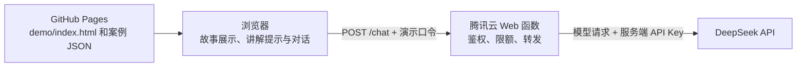

# 架构与部署

页面从同一站点加载 `examples/index.json`。点击「讲解案例」后，再读取选中的案例，把材料与讲解要求放进一条 `system` 消息。追问沿用该案例，同时发送最近的对话。切换案例后，话题从新案例开始，「新对话」会清除当前案例上下文。

浏览器只在当前页面内存中保留口令和对话。腾讯云函数校验口令，将消息转发到 DeepSeek，并把回答以 JSON 返回。网页以纯文本显示回答。本地的 `scripts/dev.cjs` 在回环地址提供 `/demo/` 测试页和相同的 API 处理器，默认在上游调用处返回模拟结果。接口自测位于 `tests/api.cjs`。

## 案例库

每个案例一个 JSON，文件名使用小写字母、数字和连字符。新增案例时，在 `examples/index.json` 的 `cases` 中增加一项，其中 `id`、`title`、`tags` 与案例文件一致，`file` 填文件名。以现有三个案例为模板。

| 字段 | 内容 |
| --- | --- |
| `id`、`title`、`tags` | 唯一编号、课堂标题和主题标签 |
| `story` | 约 150–250 字的开场故事。含 `type`、`text`、`source_ids` |
| `context` | `time`、`location`、`project_type`、`background`、`source_ids` |
| `facts` | 每条含 `id`、`text`、`source_ids`，口径与来源一致 |
| `analysis` | 每条含 `concept`、`interpretation`、`fact_ids`，说明解读所依据的事实 |
| `sources` | 每条含 `id`、`title`、`publisher`、`date`、`url` |
| `notes` | 可选。记录待核实细节、人物区分或报道范围 |

`source_ids` 指向同一文件中的 `sources[].id`，`fact_ids` 指向 `facts[].id`。确认报道区分了实际成果、计划和当事人表态。案例库随 Pages 公开发布。

## 部署

1. 在腾讯云创建 Node.js 20.19 Web 函数。监听端口设为 9000，执行超时设为 120 秒。现有函数位于广州 `default` 命名空间，名称为 `Deepseek`。
2. 把 `cloud-function/app.js` 和 `cloud-function/scf_bootstrap` 放在云函数代码包根目录。启动脚本使用 LF，打包前在 Linux 或 Git Bash 执行 `chmod +x scf_bootstrap`。代码没有 npm 依赖。
3. 在函数配置中填写 `DEEPSEEK_API_KEY`、`DEMO_ACCESS_CODE`（至少 12 位）和 `ALLOWED_ORIGINS`。后者是以逗号分隔的精确来源，现有值为 `https://nekobenzene.github.io`，只填协议、域名和必要的端口。
4. 启用函数 URL 的公网 HTTPS 入口。云端 URL 的授权类型采用「开放」，聊天鉴权与 CORS 由函数代码处理。用 `GET /health` 和 [协议里的请求示例](api.md) 检查服务。
5. GitHub Pages 使用分支发布，选择 `main` 和 `/ (root)`。测试页的公开路径是 `/XGpre/demo/`。更换云函数地址时，同步更新 `demo/index.html` 的 `API_URL` 和 CSP 的 `connect-src`，再部署页面。组织或用户名变动时，也重新配置函数的 `ALLOWED_ORIGINS`。

函数 URL 是腾讯云提供的测试入口。正式长期使用时可在腾讯云绑定自己的域名，并按上面的步骤更新页面地址和来源配置。
